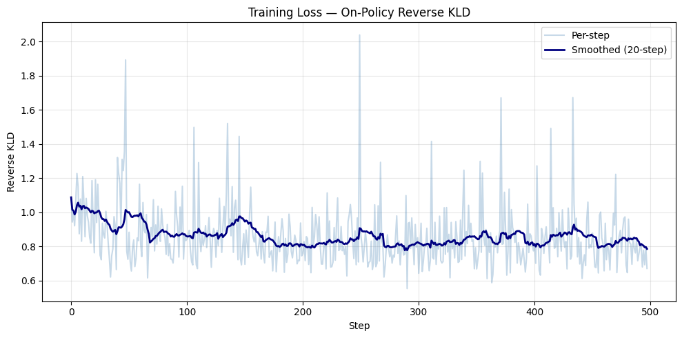

# Small Language Model for Indian History: On-Policy Reverse-KL Distillation

Distilling a frozen **Qwen3-8B** teacher into a **Qwen3-1.7B** student on a self-curated benchmark of 580 Indian-history essay questions, using **on-policy reverse-KL knowledge distillation** (the student samples its own answers, the teacher scores every token, and the student minimises KL(student ‖ teacher) on those tokens). Student and base model are then scored on a held-out set by a GPT-5.4 LLM-as-a-judge.

- **Live demo**: https://huggingface.co/spaces/ruhzi/SLM
- **Model weights**: https://huggingface.co/ruhzi/Indian_History_SLM
- **Training pipeline**: [`distill_indian_history.ipynb`](distill_indian_history.ipynb)
- **Evaluation**: [`llm_as_a_judge.ipynb`](llm_as_a_judge.ipynb)

## Why this setup

- **Domain**: Indian history is a domain where small models hedge badly on contested topics (Partition, Emergency, Article 370, communal riots). The benchmark was built to be heavy on exactly those questions.
- **On-policy distillation** instead of SFT on teacher outputs: the student is corrected on *its own* distribution of mistakes rather than imitating teacher text it would never have produced. Reverse KL is mode-seeking, so the student commits to the teacher's preferred answer rather than averaging over all plausible ones.
- **Non-thinking mode** (`enable_thinking=False`) for both models so the distillation signal is on the answer tokens, not on hidden reasoning traces.

## Dataset

`fully_tagged_dataset.jsonl`: 580 questions, one per line, in chat format with two labels each.

```json
{"messages": [{"role": "user", "content": "\"The Harappans were not an artistic people.\" Comment."}],
 "time_period_tag": "TP-A", "tonal_tag": "T-A"}
```

Each question carries exactly one tag from each taxonomy (full definitions in [`docs/dataset_taxonomy.md`](docs/dataset_taxonomy.md)):

| Time period | Count | | Tonal / intent | Count |
|---|---|---|---|---|
| TP-A Pre-colonial | 138 | | T-A Explanatory / analytical | 285 |
| TP-B Colonial (1757–1947) | 280 | | T-B Normative / ethical | 21 |
| TP-C Early republic (1947–1977) | 141 | | T-C Perspective-based / ideological | 61 |
| TP-D Contemporary (1977–) | 21 | | T-D Debate / contested | 213 |

The train/eval split is stratified on the (tonal, time-period) pair with at least one eval example per pair, giving 498 train / 82 eval questions.

## Method

For every training question:

1. Format with the Qwen3 chat template and a fixed historian system prompt.
2. **Rollout**: the student samples a completion (temperature 0.7, top-p 0.8, top-k 20, up to 512 new tokens).
3. **Score**: teacher and student both run a forward pass over prompt + completion.
4. **Loss**: per-token reverse KL on completion positions only, `Σ_v p_s(v) · (log p_s(v) − log p_t(v))`, averaged over unmasked tokens.
5. Backprop through the student; Adafactor update every 8 micro-batches with gradient clipping at 1.0, linear warmup then cosine decay.

| Setting | Value |
|---|---|
| Teacher | `Qwen/Qwen3-8B`, bf16, frozen |
| Student | `Qwen/Qwen3-1.7B`, bf16, full fine-tune, gradient checkpointing |
| Epochs | 1 (498 rollouts, 62 optimizer steps) |
| Effective batch | 8 (micro-batch 1 × grad-accum 8) |
| LR | 2e-5, 10 % warmup, cosine decay |
| Max prompt / rollout / sequence | 384 / 512 / 896 tokens |
| Hardware | 1× A100 40 GB (Colab) |

## Training



Reverse KL falls from roughly 1.0 at the start of training to about 0.8 by the end. The earlier logged run (Qwen3-4B teacher on an L4, preserved in git history) reported a first-third average of 0.911 against a last-third average of 0.842, with an epoch mean of 0.858. Almost all wall-clock time is spent in the on-policy rollout: 126 of 131 minutes in that run.

## Evaluation: GPT-5.4 as judge

Both the distilled student and the untouched base Qwen3-1.7B answer the 82 held-out questions with identical prompts and sampling settings (`eval_student_generations.jsonl`, `eval_base_generations.jsonl`). Each answer is then scored independently by **GPT-5.4** (via OpenRouter, JSON mode) on a 1–5 rubric across four categories, weighted towards presentation: structure and formatting, academic tone, thematic coherence, and broad factual relevance. The scored files are `scored_eval_student_generations.jsonl` and `scored_eval_base_generations_updated.jsonl`; three student answers failed to parse and are excluded (79 paired questions).

| Mean score (1–5) | Distilled student | Base Qwen3-1.7B |
|---|---|---|
| Structure and formatting | **3.54** | 3.24 |
| Academic tone | 3.47 | **4.02** |
| Thematic coherence | 3.54 | **4.30** |
| Broad relevance | 3.96 | **4.65** |
| **Overall (mean of 4)** | 3.63 | **4.06** |

Paired by question, the student scores higher on 16, lower on 49, and ties on 14. The student's answers are longer (median 280 vs 191 words) and use markdown structure more often (40 vs 26 of 82), which is where its structure gain comes from; the base model scores higher on tone, coherence and relevance. By bucket, the gap is largest on explanatory questions (T-A: 3.40 vs 4.01) and pre-colonial questions (TP-A: 3.63 vs 4.25), and closes to zero on the small contemporary (TP-D) and normative (T-B) buckets.

## Running it

Both notebooks are written for Google Colab.

**Distillation** (`distill_indian_history.ipynb`, GPU runtime):

1. Pick an A100 (an L4 works with the smaller Qwen3-4B teacher).
2. Upload `fully_tagged_dataset.jsonl` to the runtime.
3. Run the cells top to bottom. Cell 1 removes Colab's torchvision/torchaudio builds, which otherwise crash `transformers` on import.
4. Artifacts (model, tokenizer, `training_metadata.json`, eval generations, loss plot) are written to Google Drive in the last cells.

**Judging** (`llm_as_a_judge.ipynb`, no GPU needed):

1. Add an `OPENROUTER_API_KEY` secret in Colab.
2. Upload the two `eval_*_generations.jsonl` files and run top to bottom.

Local dependencies are listed in `requirements.txt`.

## Repository layout

```
distill_indian_history.ipynb                 # data -> models -> distillation -> eval generation -> save
llm_as_a_judge.ipynb                         # GPT-5.4 scoring of both models + comparison tables
fully_tagged_dataset.jsonl                   # 580 tagged questions
eval_student_generations.jsonl               # distilled student answers on the 82 eval questions
eval_base_generations.jsonl                  # base Qwen3-1.7B answers on the same questions
scored_eval_student_generations.jsonl        # the above with GPT-5.4 scores attached
scored_eval_base_generations_updated.jsonl
docs/dataset_taxonomy.md                     # tagging rules for the two taxonomies
assets/training_curves.png                   # loss curve from the recorded run
requirements.txt
```
